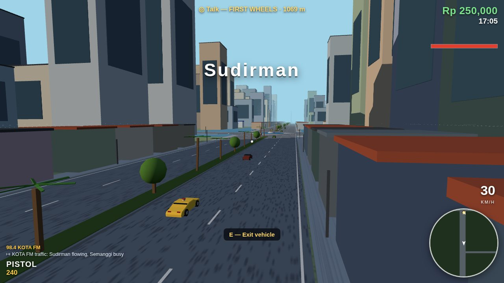
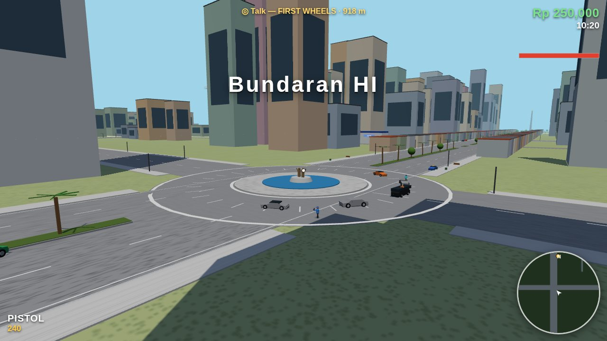
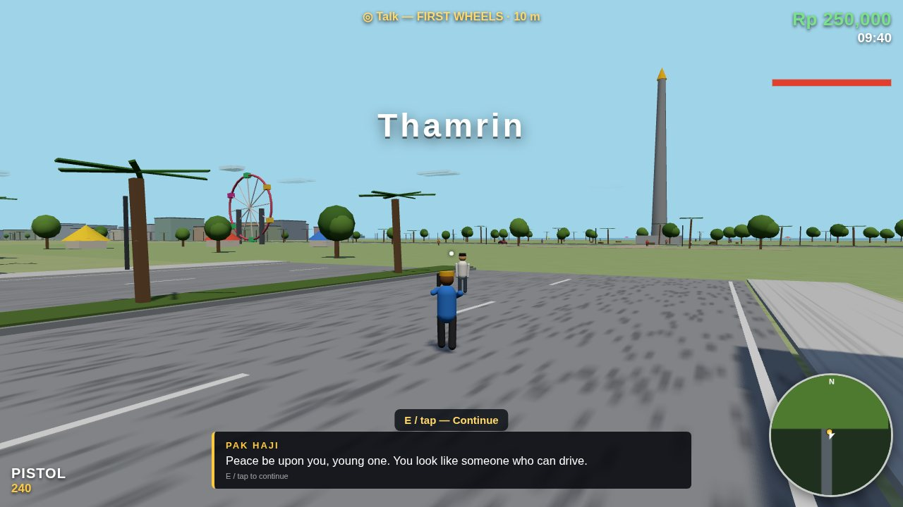
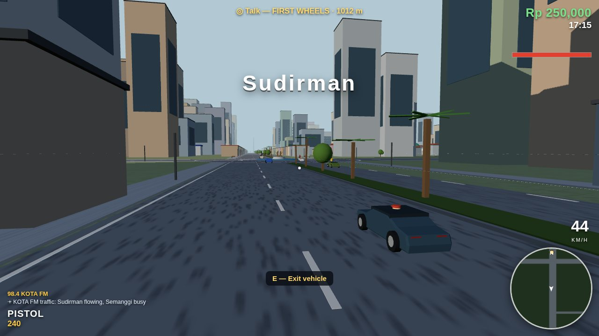

# Jakarta City

A complete open-world action game set in a fictionalised Jakarta: an island city of roughly 1.6 × 2.3 km built with three.js, yours to roam from the first minute. Walk it, drive it, work its jobs, outrun its police — there is no corridor and no waiting for the map to open up. It is all already there.

## The World

The island runs on a real road grid: three great avenues, five east–west arterials, a ring road around the coast, and the Gatot Subroto diagonal cutting through the Semanggi interchange, flyover included. At the centre sits Bundaran HI, a working roundabout with its welcome monument standing in the fountain pool. North of it, Monas rises over its park and carnival corner; west, the GBK stadium fills Senayan park. Around them the districts each keep their own character — the old blocks of Kota Tua, the garden streets of Menteng, the glass of Kuningan, the towers of Grogol, the malls of Blok M — and two kampungs pack their little houses along gang lanes strung with laundry lines. Ancol beach runs along the north shore with its pier and a working port, and planted medians split the wide avenues. There are no street signboards cluttering the view: the city simply tells you where you have arrived, by name, as you cross into each area.

## Gameplay

Traffic is routed on the road graph itself: around fifty cars and bikes turn at junctions, keep left, queue behind each other and find new routes when they get stuck, and parked cars along the avenues are yours to steal. A hundred pedestrians walk the sidewalks, sit in the kampungs and run when things get loud. A five-mission story, told through NPC dialogue, takes you from a first favour for an old man at the Monas gate to a final run with the police on your tail; between missions the phone offers delivery and ojol work anywhere in the city. The police answer back properly — foot officers who deploy from patrol cars and shoot on foot, pursuit drivers, a roadblock at five stars and a helicopter with a searchlight at four — and the old rules hold: you are only BUSTED when you are knocked down and an officer reaches you, and WASTED when your health is gone. Six weapons, from fists and a machete to a pump shotgun and a rifle, are sold at the gun shop. Step inside the STAR KARAOKE bar or a kampung house, take a boat out from the beach or the pier, respray your car at the BENGKEL Pay N Spray — from the driver's seat — surrender at the POLSEK, get patched up at the RSUD, buy the house with the For Sale sign and make it your save point. Cheat codes, of course, are typed the way they always have been.

## Living city

A full day turns over the island, starting at noon: the sun crosses, dusk comes down orange, street lights take over, the moon and stars come out. Clouds drift, rain rolls in off the bay and clears again. In a car you get a working speedometer, five radio stations with traffic tickers, and a minimap that tracks you, your objective and the police; the full world map is one key away, drawn from the same road data the traffic drives on.

## Controls

Desktop: WASD to walk and drive, mouse drag for the camera, click to shoot or swing, E to interact and to get in and out of vehicles and boats, Shift to run, Space for the handbrake, 1–6 for weapons, R for the radio, M for the world map. On touch devices a stick and buttons appear — and only there.

Every line of code and every model in this game is original work made for this entry; no third-party game assets are used. The three.js library is vendored under `game/vendor/`.
